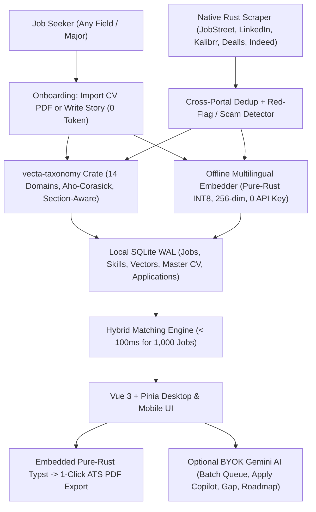

# Vecta

**Local-First Universal Career Intelligence OS for Desktop & Mobile**

Vecta is a privacy-first career platform built with **Tauri 2.0, Rust, SQLite WAL, and Vue 3** that helps job seekers across **all 14 Indonesian academic and professional domains** discover relevant vacancies, measure honest skill gaps, avoid recruitment scams, export tailored ATS-friendly PDF resumes, track applications, and follow structured learning roadmaps.

Core discovery, PDF CV import, multi-portal scraping, cross-domain skill matching, 101-language semantic embeddings, scam/red-flag detection, and 1-click ATS PDF export run **100% locally on your device with zero API keys and zero cloud lock-in**. Optional generative workflows (Cover Note Copilot, deep Gap Analysis, Learning Roadmaps) support **BYOK (Bring Your Own Key)** via Google Gemini API with built-in batching and Free-Tier RPM protection.

---

## Key Capabilities

| Pillar | What Vecta Delivers | Runtime & Cost |
| :--- | :--- | :--- |
| **14-Domain Taxonomy (`vecta-taxonomy`)** | Pure-Rust Aho-Corasick skill extractor covering IT/Data, Finance/Tax (PSAK, Brevet A/B, e-Faktur), Marketing/Sales, HR/Payroll/BPJS, Civil/Architecture (ETABS, RAB, GIS), Mechanical/Electrical/K3-HSE, Health/Pharma (CPOB, BPOM), Legal/Compliance (OSS, UU PDP), Creative/Media, Agri/Food (HACCP), Education (Kurikulum Merdeka), Hospitality, Lab Science (HPLC, ISO 17025), and Soft Skills. Includes section-aware parsing (`About Us` noise filtering), domain disambiguation, and parent-child partial skill credit. | Pure Rust, `< 1 ms/job`, 0 tokens |
| **101-Language Offline Semantic AI** | Pure-Rust quantized INT8 multilingual embedding runtime (`potion-multilingual-128M`, distilled from `BAAI/bge-m3`, 256 dims, 500k vocab) supporting Bahasa Indonesia and English with zero ONNX Runtime C++ dependencies. | Pure Rust, `< 0.3 ms/job`, 0 API keys |
| **Zero-Setup Native Rust Scraper** | Built-in Rust scrapers for **JobStreet**, **LinkedIn Guest**, **Kalibrr**, **Dealls**, and **Indeed RSS** (no separate Python server required; Python FastAPI worker remains available as an optional fallback). Includes cross-portal deduplication (`+N portal`) and an Indonesian recruitment scam / red-flag detector. | Pure Rust `reqwest` + `scraper`, 0 tokens |
| **Instant PDF CV Import & ATS PDF Studio** | Drop an existing `.pdf` resume to extract profile, skills, and search keywords in under 30 seconds (0 tokens). Maintain a single **Master CV** in SQLite and export a tailored, single-column, ATS-verified `.pdf` per job via embedded **Typst**. | Pure Rust `pdf-extract` + `typst-pdf`, `< 50 ms` |
| **Application Pipeline & Retention** | Full application tracker (`Baru`, `Disimpan`, `Dilamar`, `Interview`, `Offer`, `Ditolak`, `Disembunyikan`), personal notes, 7-day follow-up reminders, and Interview Prep prompts tied to matched and missing skills. | Local SQLite WAL |
| **Optional BYOK Gemini Copilot** | Decoupled, resumable AI queue (5 jobs/call batch extraction + `:batchEmbedContents` + sliding-window RPM rate limiter), tailored CV bullets & cover notes (`ID`/`EN`), Gap Analysis, and Learning Roadmaps cached locally in SQLite. | Optional BYOK Gemini API (`gemini-3.5-flash-lite` & `gemini-embedding-001`) |

---

## Architecture Overview



---

## Repository Structure

```text
Vecta/
├── Cargo.toml                         # Rust workspace root + size-optimized release profile
├── crates/
│   └── vecta-taxonomy/                # Standalone 14-domain Indonesian skill taxonomy & precision benchmark
├── apps/
│   └── client/
│       ├── src/                       # Vue 3.5 + TypeScript + Tailwind CSS v4 + Pinia + Vue Router
│       └── src-tauri/                 # Tauri 2.0 Rust Core (SQLite WAL, Native Scraper, Offline AI, Typst PDF)
│           └── resources/
│               ├── fonts/             # Bundled open-source ATS fonts (Inter / Roboto)
│               └── models/            # Offline INT8 multilingual model directory (generated via script)
├── services/
│   └── scraper-worker/                # Optional Python 3.13 FastAPI + python-jobspy worker
├── shared/
│   ├── migrations/                    # Ordered SQLite WAL schema migrations (001 through 004)
│   ├── schemas/                       # JSON Schemas for Gemini Structured Outputs
│   ├── taxonomy/                      # 14 curated Indonesian + English domain JSON skill packs
│   └── templates/                     # Pure-Rust embedded Typst ATS resume templates
├── scripts/
│   └── fetch_offline_ai_model.py      # Reproducible builder for the 124 MB INT8 offline AI model
├── docs/
│   ├── audits/                        # Security, system, and UI audit reports
│   └── mobile-build-guide.md          # Tauri 2.0 Android & iOS cross-compilation guide
├── LICENSE                            # MIT License
├── SECURITY.md                        # Local-first security & privacy model
└── CONTRIBUTING.md                    # Guide for contributing skills, scrapers, and code
```

---

## Quick Start

### Prerequisites

- **Rust** (stable toolchain + Visual Studio C++ Build Tools on Windows)
- **Node.js** 20+ (`npm`)
- **Python 3.11+** with `numpy` (only needed once to build the quantized offline AI model, or if running the optional Python scraper worker)

### 1. Clone & Prepare the Offline Multilingual AI Model (~142 MB)

Because GitHub limits standard repository files to 100 MB, the quantized 101-language embedding model is built locally in one command before running or packaging Vecta:

```bash
git clone https://github.com/Natvelniel/Vecta.git
cd Vecta
python scripts/fetch_offline_ai_model.py
```

This downloads `minishlab/potion-multilingual-128M` (MIT license) from Hugging Face, quantizes the 500,353-token embedding table to per-row INT8 (`embeddings_i8.vemb`, ~124 MB), saves `tokenizer.json` into `apps/client/src-tauri/resources/models/potion-m128-i8/`, and removes the temporary full-precision file.

*(Vecta also runs gracefully without this model using the 14-domain `vecta-taxonomy` + local keyword scorer.)*

### 2. Install Frontend Dependencies & Run Development Mode

```bash
cd apps/client
npm install
npm run tauri dev
```

### 3. Build Release Desktop Binary

```bash
cd apps/client
npm run tauri build
```

For Android (`arm64-v8a`) and iOS packaging instructions, see [docs/mobile-build-guide.md](docs/mobile-build-guide.md).

### Optional: Running the Python Scraper Worker Fallback

Native Rust scraping is active by default and requires zero Python setup. If you want to enable the optional `python-jobspy` fallback in **Settings -> Mode Pengambil Lowongan**:

```bash
cd services/scraper-worker
uv sync
uv run uvicorn app.main:app --host 127.0.0.1 --port 8000
```

---

## Verification & Quality Benchmarks

Run the full automated verification suite across all layers:

```bash
# 1. Rust workspace tests (69 tests: 14-domain Precision/Recall benchmark,
#    offline multilingual semantic ranking, embedded Typst ATS PDF roundtrip,
#    red-flag detector, cross-portal dedup, SQLite migrations & <100ms matching)
cargo test --workspace

# 2. Frontend TypeScript check, Vitest store tests & production build
cd apps/client
npm run typecheck && npm test && npm run build

# 3. Optional Python Scraper Worker tests
cd ../../services/scraper-worker
uv run pytest -q
```

Verified metrics:
- **Taxonomy Precision / Recall Gate:** `Precision >= 0.95`, `Recall >= 0.92` across 14 real-world Indonesian cross-domain job fixtures (`crates/vecta-taxonomy/tests/benchmark.rs`).
- **Local Matching Throughput:** 1,000 jobs loaded, matched, and upserted in SQLite WAL in `< 100 ms`.
- **Desktop Release Footprint:** `~38.8 MB` native binary + `~143.6 MB` bundled offline 101-language AI model & ATS fonts (`~182.4 MB` total offline package).

---

## Security & Privacy

- **Zero Cloud Telemetry:** Resumes, skills, job lists, application notes, and gap analyses stay strictly inside local SQLite WAL.
- **Zero Secrets in Database:** Optional Gemini API keys are stored exclusively in the OS Credential Manager (Windows Credential Manager, macOS Keychain, Linux Secret Service) and masked in UI responses.
- **Anti-SSRF & Input Hardening:** Loopback-only host validation (`127.0.0.1`, `localhost`, `::1`) with redirects disabled for optional local workers, strict `http(s)` URL scheme validation, and `%PDF-` magic-bytes + 10 MB upload cap on PDF imports.

See [SECURITY.md](SECURITY.md) for details.

---

## Third-Party Licenses & Attribution

- **Offline Multilingual Model:** `minishlab/potion-multilingual-128M` (MIT License, distilled from `BAAI/bge-m3`).
- **ATS PDF Engine:** `Typst` / `typst-pdf` (Apache-2.0 License).
- **Bundled ATS Fonts:** `Inter` (SIL Open Font License 1.1) and `Roboto` (Apache-2.0 License).
- **Taxonomy References:** Structured with open concepts aligned to Indonesia's PDDikti academic domains, KBJI BPS, SKKNI, ESCO, and O*NET.

---

## License

Released under the [MIT License](LICENSE). Copyright (c) 2026 Natvelniel.
